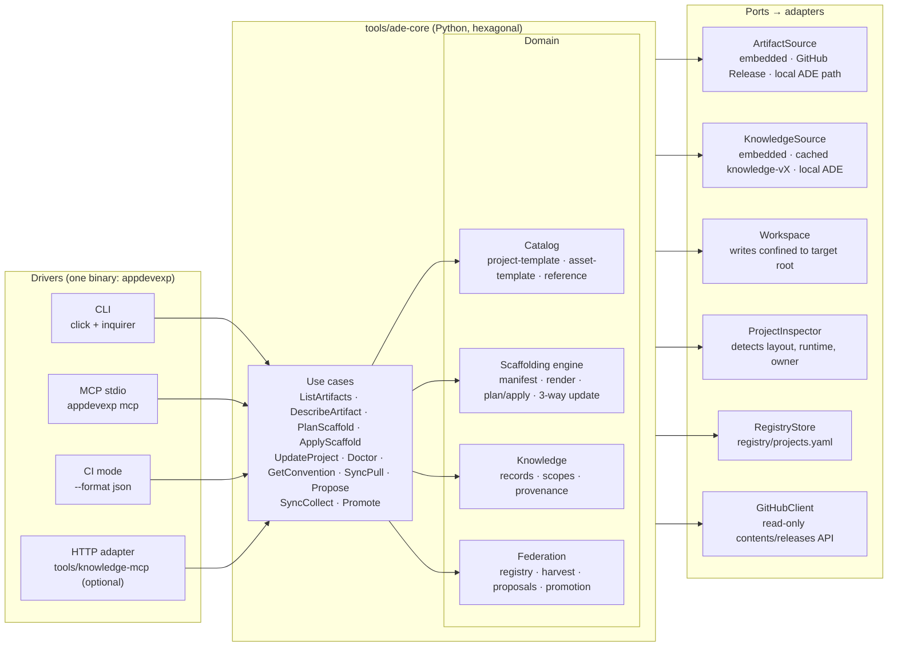
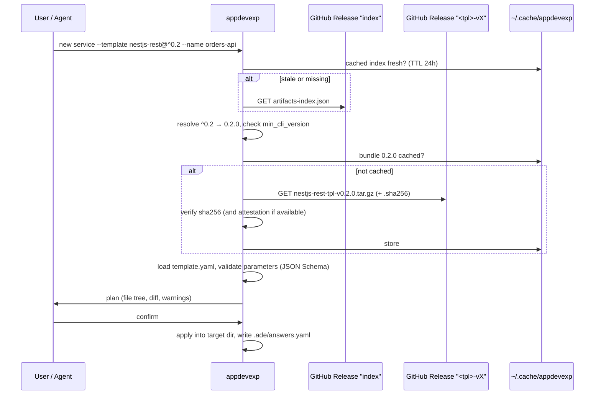

# ADE Scaffolding and Knowledge Platform — Architecture Analysis

- Status: Proposal (analysis). Decisions to be promoted to an ADR (`docs/adr/0003-…`) once accepted.
- Date: 2026-11-13
- Author: ADE platform maintainers (drafted with Claude Code)
- Audience: software architects and maintainers of ADE templates, `cli/`, and `tools/knowledge-mcp/`

> **Objective.** ADE exists to **export its knowledge** — conventions, backend
> templates, pipelines, infrastructure patterns — so other projects can reuse it.
> This analysis designs a single platform that (a) scaffolds new projects from
> parameterized, versioned templates, (b) serves ADE conventions to humans and
> agents, and (c) **learns back** from the projects that adopted it.

---

## 0. Questions, answered up front

| # | Question | Answer |
|---|---|---|
| 1 | What is the best way to manage scaffolding of backend templates? | **One Python core, many drivers, one binary.** The `appdevexp` binary (already a PyInstaller build in `cli/`) gains `new`, `add`, `update`, `doctor`, and an MCP stdio server (`appdevexp mcp`). All of them call the same core. Templates stay **living, runnable projects** in `backend/`, each described by a `template.yaml` manifest. The root `Makefile` `create-*` targets are deprecated. See §2–§4. |
| 2 | CLI, or the ADE project as a binary used as MCP by other projects? | **Both, from the same binary.** The CLI suits humans and CI. `appdevexp mcp` suits agents. Neither duplicates logic. `tools/knowledge-mcp` becomes a thin adapter over the core, kept for Docker-only users. See §2 and §7. |
| 3 | Can templates be published as GitHub artifacts, fetched at the latest version, and customized by parameters? | **Yes — and half of it already exists.** `generate-release-changelog` already attaches a scoped `nestjs-rest-tpl-v0.1.2.tar.gz` to its GitHub release, and the repo is public. What is missing is a manifest inside each bundle, checksums, a version index, and release jobs for the other two templates. See §3. |
| 4 | Should GitHub workflows (and similar assets) be copied and customized deterministically, instead of generated with GenAI tools? | **Yes, with one refinement: Reference > Render > Generate.** *Reference* shared logic: reusable workflows and composite actions pinned by tag, nothing copied. *Render* only the thin, parameterized caller files. Leave GenAI only the parts no template can cover. See §5. |
| 5 | Can ADE learn from the projects that use it? | **Yes, through a federated hub and spoke model.** Every child project owns a small `.ade/` directory (receipt, exceptions, proposals, compliance snapshot). ADE harvests it read-only with `appdevexp sync collect`. Knowledge reaches the org scope **only through a reviewed PR** that edits ADE's single source of truth. See §6. |
| 6 | A `sync` command that gathers standards from child projects? | **Yes, with an explicit direction per subcommand.** `sync pull` (child gets org knowledge), `propose` (child records a learning), `sync collect` (ADE gathers from every registered child), `promote` (ADE turns a learning into a canonical change via PR). See §6.4. |

---

## 1. Current state

### 1.1 Three scaffolding approaches that do not agree

| Dimension | Root `Makefile` `create-*` | `tools/knowledge-mcp` | `cli/` (`appdevexp`) |
|---|---|---|---|
| What it does | Copies `backend/<tpl>` into `examples/<name>` | Tells the caller *which* template path to copy, plus the lifecycle rules (`scaffold_guidance`). Checks a manifest for gaps (`compare_gaps`) | Conventional commits only (`commit`, `status`) |
| Parameters | Only the service name (`NODEJS_NEW_GQL_SERVICE`, …) | `component_type` | n/a |
| Renaming | Only the GQL target `sed`s `package.json` / `package-lock.json`. REST and FastAPI keep the template name | None (it doesn't write files) | n/a |
| What gets copied | Everything, including `node_modules`, `.venv`, `coverage`, `dist`, `.pytest_cache`, `.coverage` | n/a | n/a |
| Output | `examples/` (gitignored), wiped by `clean-examples` | n/a | n/a |
| Distribution | Requires an ADE clone | Requires an ADE clone mounted with `-v <ADE_ROOT>:/repo:ro` plus a locally built Docker image | PyInstaller binary (`cli/appdevexp.spec`), **never released** |
| Usable by agents | No | Yes (read-only) | No |
| Can upgrade a generated project later | No | No | No |

`tools/knowledge-mcp/data/scaffold.yaml` already says: *"Do not treat root
Makefile create-\* targets as the product contract."* The root targets are
legacy in practice. Nothing has replaced them yet.

### 1.2 Template identity is hard-coded

Every template carries its own name in several files. A generated project
must rewrite all of them.

| Template | Files containing the template name |
|---|---|
| `fastapi-rest-tpl` | `.env.public` (`COMPOSE_PROJECT_NAME`), `pyproject.toml` (`name`), `uv.lock`, `project.json`, `docker-compose/docker-compose.local.yml` (`container_name`), `README.md`, `src/infrastructure/settings.py` (`APP_NAME`) |
| `nestjs-rest-tpl` | `.env.public`, `package.json`, `package-lock.json`, `project.json` (`name`, `sourceRoot`, every `cwd`), `docker-compose/docker-compose.local.yml`, `README.md` |
| `nestjs-gql-tpl` | Same as NestJS REST, plus `docker-compose/docker-compose.yml` |

### 1.3 Publishing, workflows, and drift (verified 2026-11-13)

| Area | Finding | Source |
|---|---|---|
| Template releases | `generate-release-changelog` archives **only the template's working directory** (`zip`/`tar.gz`) and attaches it to a GitHub release tagged `<tpl>-vX.Y.Z` | `.github/actions/generate-release-changelog/action.yml` |
| Release coverage | `release.yml` has a job **only for `nestjs-rest-tpl`**. `fastapi-rest-tpl` was last released at `v0.1.1` (2025-07-13). `nestjs-gql-tpl` has never been released | `.github/workflows/release.yml`, `gh release list` |
| Version mismatch | Release title `nestjs-rest-tpl v0.1.2`, but its changelog body starts with `## 1.0.0` | release `nestjs-rest-tpl-v0.1.2` |
| Repo visibility | `infojasyrc/app-developer-experience` is **public**, so releases, reusable workflows and actions can be consumed without auth | `gh repo view` |
| Workflow templates | `devops/ci-aws-backend.yml` and its siblings are **fully commented out**, with placeholders (`backend/project/`, `us-east-1`, `backend-service`, `cluster-app`) | `devops/*.yml` |
| Reusable logic | Real, parameterized composite actions exist in `.github/actions/` (`container-build`, `container-regisry-push-and-metadata`, `ecs-deploy`, `image-size-report`, `get-changed-packages`), but they are referenced **only locally** (`uses: ./.github/actions/…`). **No workflow uses `on: workflow_call`** | `.github/workflows/ci_cm_components.yml` |
| Path drift | `scaffold.yaml` maps `mobile-expo` to `mobile-app/whitewolf-rn/`; the real directory is `mobile-app/caraxes/` | `tools/knowledge-mcp/data/scaffold.yaml` |
| Path drift | `scaffold.yaml` and `monorepo-paths.md` list `CI_AWS_BACKEND` / `CI_AWS_WEBAPP` as directories (`devops/ci-aws-backend/`); they are files (`devops/ci-aws-backend.yml`) | same, plus `agents/shared/context/monorepo-paths.md` |
| Knowledge feedback | Learning from consumers is manual: *"open a pull request on app-developer-experience"* | `docs/KnowledgeMCP.md` Step 8 |
| Knowledge model | `ConventionRecord{topic, scope_glob, source_path, content, tags}`. There is no notion of *where* a record came from (org vs a consumer project) or which version it belongs to | `tools/knowledge-mcp/src/knowledge/models.py` |

---

## 2. Target architecture — one core, many drivers

### 2.1 Options considered

| Option | Verdict | Why |
|---|---|---|
| A. Keep extending the root `Makefile` | Rejected | No typed parameters, shell `sed`, only works inside an ADE clone, can't be called by agents, can't upgrade |
| B. Make `knowledge-mcp` write files and use it as the only channel | Rejected as *sole* channel | Docker-only, needs the ADE mount, unusable by humans or CI without an MCP client |
| C. A standalone CLI only | Rejected as *sole* channel | Agents lose schema discovery, elicitation, and conventions in the same session |
| **D. One core with CLI, MCP and CI drivers, shipped as one binary** | **Recommended** | One implementation of every rule; humans, agents and CI see identical behavior; binary needs no host Python/Node |

**Engine choice.** Use a small, custom, **manifest-driven** engine, not
Copier or Cookiecutter.
- **Why:** ADE templates must stay buildable, lintable and testable in ADE's
  own CI (`make lint`, `make unit-tests`, 80% coverage). Jinja-suffixed
  sources (`package.json.jinja`, `{{ name }}` inside code) would break that.
- **What we borrow from Copier:** the answers-file receipt and the
  "re-render old and new, then 3-way merge" update model.

### 2.2 Components



### 2.3 Where the code lives and what is reused

| New / changed | Path | Reuses |
|---|---|---|
| Core library | `tools/ade-core/` (new package) | `tools/knowledge-mcp/src/knowledge/{ingest,catalog,store,scaffold,gaps,sync}.py`, `data/scaffold.yaml`, `data/reference.yaml` (moved, not copied) |
| Binary | `cli/` (`appdevexp`) | Existing click group, `commit` / `status` commands, `appdevexp.spec` (extended to bundle `knowledge.json` and template bundles as PyInstaller `datas`) |
| HTTP/stdio adapter | `tools/knowledge-mcp/` | Becomes a thin FastAPI + FastMCP wrapper over `ade-core`; its image stays for Docker-only users |
| Template manifests | `backend/<tpl>/template.yaml` | Template sources stay as they are |
| Reusable CI | `.github/workflows/reusable-*.yml` (`on: workflow_call`) | Existing composite actions in `.github/actions/` |

Make stays the **Unified CLI Facade** (ADR 0001) inside ADE: `make sync`,
`make unit-tests`, etc. still wrap the container engine. Generated projects
also keep their Makefile and Dockerfile. The binary is a *distribution*
channel for other repos. It is not a second entry point inside ADE packages.

---

## 3. Publishing and fetching templates from GitHub (Q3)

### 3.1 Is it possible? Yes

The publishing half exists: each `nestjs-rest-tpl` release already carries a
scoped `nestjs-rest-tpl-vX.Y.Z.tar.gz`. Because the repo is public, anyone can
download the asset without a token. The work left:

1. **Release every template.** Add `release-fastapi-rest-tpl` and
   `release-nestjs-gql-tpl` jobs to `release.yml` (the changed-package keys
   `tpl-fastapi-rest` and `tpl-nestjs-gql` already exist in
   `get-changed-packages.sh`). Add matching `changelog:*` scripts in the root
   `package.json`.
2. **Fix the version mismatch** between the release title and the changelog
   header.
3. **Ship the manifest inside the bundle.** `template.yaml` travels with the
   template, so a template can gain a new parameter without a CLI release.
4. **Add integrity.** Attach `<asset>.sha256`. Optionally add a build
   provenance attestation (`actions/attest-build-provenance`), which the CLI
   verifies with `gh attestation verify` when `gh` is available.
5. **Publish an index** so the CLI can resolve versions without calling the
   GitHub API.

> **Status (Phase 0, 2026-11-13).** Items 1, 2 and the `.sha256` part of 4
> are implemented. Releases are now **tag-only**: the active `main` ruleset
> (PR required, no bypass actors) blocks the former "commit version +
> CHANGELOG to `main`" step, so the action tags the merge commit server-side
> and stamps the version only into the bundle. The mismatch came from
> `conventional-changelog` reading the root `package.json` version; the
> action now pins it with `--context`. Runbook:
> `docs/standards/release-strategy.md`.

### 3.2 Bundle and index format

```text
nestjs-rest-tpl-v0.2.0.tar.gz
├── template.yaml          # manifest (schema version, parameters, transforms)
├── package.json …         # the living template, unchanged
└── …                      # node_modules, coverage, dist excluded by the manifest
nestjs-rest-tpl-v0.2.0.tar.gz.sha256
```

`artifacts-index.json` is attached to a rolling release tagged `index`,
which the release workflow regenerates:

```json
{
  "index_schema": 1,
  "generated_at": "2026-11-13T00:00:00Z",
  "artifacts": {
    "nestjs-rest": {
      "kind": "project-template",
      "tag_prefix": "nestjs-rest-tpl-v",
      "latest": "0.2.0",
      "versions": {
        "0.2.0": {
          "url": "https://github.com/infojasyrc/app-developer-experience/releases/download/nestjs-rest-tpl-v0.2.0/nestjs-rest-tpl-v0.2.0.tar.gz",
          "sha256": "…",
          "manifest_schema": 1,
          "min_cli_version": "0.3.0"
        }
      }
    },
    "ci-aws-backend": { "kind": "asset-template", "tag_prefix": "workflows-v", "latest": "1.0.0", "versions": {} },
    "knowledge":      { "kind": "knowledge",       "tag_prefix": "knowledge-v", "latest": "1.0.0", "versions": {} },
    "appdevexp":      { "kind": "cli",             "tag_prefix": "cli-v",       "latest": "0.3.0", "versions": {} }
  }
}
```

### 3.3 Resolution flow



Version specifiers: `@latest` (default), `@0.2.0` (exact), `@^0.2` / `@~0.2.1` (semver range).

| Situation | Behavior |
|---|---|
| Offline / air-gapped | Falls back to the bundle **embedded in the binary** at build time and warns which version it used |
| ADE maintainer testing an unreleased template | `--source path:./backend/nestjs-rest-tpl` reads the working copy |
| Fork or private mirror | `--registry <owner/repo>`; uses `GITHUB_TOKEN` if set |
| Rate limits | Asset downloads go through `browser_download_url` and the index, not the REST API (the unauthenticated API limit is 60 requests/hour) |

### 3.4 Release channels

| Channel | Tag | Contents |
|---|---|---|
| Project templates | `<tpl>-vX.Y.Z` (exists) | Clean template plus `template.yaml` plus checksum |
| Knowledge | `knowledge-vX.Y.Z` | `knowledge.json` (output of `make sync`) plus a checksum |
| Workflows / actions | `workflows-vX.Y.Z` plus a moving major `workflows-v1` | Reusable workflows, composite actions, caller asset-templates |
| CLI | `cli-vX.Y.Z` | `appdevexp` for `darwin-arm64`, `darwin-amd64`, `linux-amd64`, `linux-arm64`, plus a container image |
| Index | `index` (rolling) | `artifacts-index.json` |

### 3.5 Alternatives rejected

| Alternative | Why not |
|---|---|
| GitHub "template repository" | Whole-repo only, no parameters, cannot target a folder of a monorepo |
| `degit` / `git sparse-checkout` of a path | No versions, no integrity check, no manifest |
| npm / PyPI package per template | Language-specific registry for a polyglot catalog |
| OCI artifact on GHCR (`oras`) | Viable and container-first friendly. **Deferred**, because GitHub Releases already work and are public |

---

## 4. Template manifest and parameter analysis

### 4.1 Manifest (`backend/nestjs-rest-tpl/template.yaml`)

```yaml
manifest_schema: 1
artifact: nestjs-rest
kind: project-template
min_cli_version: 0.3.0
description: NestJS RESTful service (DDD, container-first)

identity:
  token: nestjs-rest-tpl            # literal replaced by {{ name }}
  files:                            # files that contain the token
    - .env.public
    - package.json
    - project.json
    - docker-compose/docker-compose.local.yml
    - README.md

exclude:                            # never copied
  - node_modules/
  - coverage/
  - dist/
  - CHANGELOG.md
  - package-lock.json               # regenerated via `make install-dependencies`

parameters:                         # JSON Schema; drives the CLI wizard and MCP elicitation
  $ref: "#/shared/backend-parameters"   # §4.2

features:
  feature_flags:
    values: [unleash, none]
    default: unleash
    when_none:
      remove_files:
        - src/infrastructure/unleash/
        - docker-compose/docker-compose.unleash.yml
      remove_dependencies: { package.json: [unleash-client] }
      remove_env: [UNLEASH_API_URL, UNLEASH_API_TOKEN, UNLEASH_DB_NAME, UNLEASH_DB_USERNAME, UNLEASH_DB_PASSWORD]
      remove_make_targets: [launch-unleash, stop-unleash]
      code_edits:                   # typed config keys referencing the removed env vars
        - file: src/infrastructure/environment-variables.ts
          remove_properties: [UNLEASH_API_URL, UNLEASH_API_TOKEN]
  database:
    values: [postgres, none]
    default: postgres
    when_none:
      remove_files: [docker-compose/docker-compose.db.yml]
      remove_env: [POSTGRES_USER, POSTGRES_PASSWORD, POSTGRES_DB]
      remove_make_targets: [launch-db, stop-db]

edits:                              # structural, format-aware (no sed)
  - file: project.json
    json_set: { sourceRoot: "{{ output_dir }}", "targets.*.options.cwd": "{{ output_dir }}" }
    when: "{{ nx_project }}"
  - file: .env.public
    dotenv_set:
      HTTP_PORT: "{{ http_port }}"
      PROJECT_NAME: "{{ project_name }}"
      COMPOSE_PROJECT_NAME: "{{ compose_project_name }}"
      PLATFORM: "{{ platform }}"
      CONTAINER_RUNTIME: "{{ container_runtime }}"
    preserve_layout: true           # keeps the .env.public ordering rule

next_steps:                         # Make targets only — never host npm/node
  - make create-volumes
  - make build-dev
  - make install-dependencies
  - make unit-tests
  - make launch-local
```

Design rules:

- **Templates stay runnable.** The manifest describes transforms *over* a
  working project, so ADE CI keeps linting and testing the template itself.
- **Lockfiles are regenerated, not edited.** They are excluded, and the first
  `make install-dependencies` in the new project recreates them inside the
  container.
- **Structural edits only.** JSON, TOML, YAML and dotenv edits are
  format-aware. The `.env.public` editor preserves the layout that
  `CLAUDE.md` mandates: service variables first, one blank line, then
  `PROJECT_NAME`, `COMPOSE_PROJECT_NAME`, `PLATFORM`, `CONTAINER_RUNTIME`.
- **A manifest CI check (Phase 1)** renders every feature combination into a
  temp directory and runs `make lint unit-tests` on each, so a manifest never
  silently rots when template files move.

### 4.2 Backend template parameters

Precedence: **CLI flag / MCP argument > answers file (`--answers`) > detected project context > template default.**

| Group | Parameter | Type | Default | Source | Validation / notes | Applies to |
|---|---|---|---|---|---|---|
| Identity | `name` | string | — (required) | flag / prompt | kebab-case, `^[a-z][a-z0-9-]{1,48}$`, must not exist in target | all |
| | `description` | string | from manifest | flag / prompt | ≤ 200 chars; goes into `package.json` / `pyproject.toml` / README | all |
| | `owner` | string | detected from `CODEOWNERS` or the git remote | detected / prompt | GitHub team or user; writes `CODEOWNERS` | all |
| | `project_name` | string | detected `PROJECT_NAME` from the target repo, else `app-dev-exp` | detected | image namespace (`<project_name>/<name>`) | all |
| | `compose_project_name` | string | `= name` | derived | `.env.public` `COMPOSE_PROJECT_NAME` | all |
| | `npm_scope` | string | none | flag | `@scope/` prefix for `package.json` | NestJS |
| | `python_package` | string | `name` with `-` → `_` | derived | `pyproject.toml` | FastAPI |
| Template | `template` | enum | — | flag / prompt | `fastapi-rest`, `nestjs-rest`, `nestjs-gql`; aliases from `scaffold.yaml` | — |
| | `language` + `api_style` | enum | — | prompt | alternative to `template`: `python`+`rest` → `fastapi-rest`; `typescript`+`rest` → `nestjs-rest`; `typescript`+`graphql` → `nestjs-gql` | — |
| Version | `template_version` | semver / range | `latest` from the index | flag | must satisfy `min_cli_version` | all |
| Runtime | `container_runtime` | enum | detected from the target `.env.public`, else `docker` | detected | `docker`, `podman`, `container` | all |
| | `platform` | enum | detected, else `linux/amd64` | detected | `linux/amd64`, `linux/arm64`, `linux/x86_64` | all |
| | `http_port` | int | `4000` (NestJS), `8000` (FastAPI) | default | 1024–65535; must not collide with other services in a detected monorepo | all |
| Features | `database` | enum | `postgres` | flag / prompt | `postgres`, `none` (MongoDB is a future value, already used by `conference-manager/shared-services`) | all |
| | `feature_flags` | enum | `unleash` | flag / prompt | `unleash`, `none` | NestJS only |
| | `auth` | enum | `jwt` | flag / prompt | `jwt`, `none` | FastAPI only (today) |
| | `migrations` | enum | `alembic` | derived | `alembic` only when `database=postgres` | FastAPI only |
| DDD | `bounded_context` | string | none | flag | **Phase 2.** Generates a first `domain/` · `application/port/{input,output}` · `adapter/{input,output}` module, following `nestjs-gql-tpl`'s layout | all |
| Destination | `layout` | enum | detected (`nx.json` present → `monorepo`) | detected | `monorepo`, `standalone` | all |
| | `output_dir` | path | `backend/<name>` (monorepo) or `./<name>` | derived | must be inside the workspace root | all |
| | `nx_project` | bool | `true` if `layout=monorepo` and `nx.json` exists | detected | writes or updates `project.json` | all |
| | `ci` | enum | `github-actions` | flag / prompt | `github-actions`, `none`; chains `appdevexp add workflow` (§5) | all |
| | `cloud` | enum | `none` | flag / prompt | `aws`, `azure`, `none`; selects the CI asset-template | all |
| | `git_init` | bool | `true` if `standalone` and no `.git` | detected | — | all |
| | `commit_conventions` | bool | `true` unless commitlint/husky are detected | detected | adds commitlint + husky (same signals as `reference.yaml` `commits`) | all |

### 4.3 Feature × template compatibility

| Feature value | `fastapi-rest` | `nestjs-rest` | `nestjs-gql` | Rejection message |
|---|---|---|---|---|
| `database=postgres` | ✅ | ✅ | ✅ | — |
| `database=none` | ✅ (also forces `migrations` off) | ✅ | ✅ | — |
| `feature_flags=unleash` | ❌ | ✅ | ✅ | "Unleash wiring exists only in the NestJS templates." |
| `auth=jwt` | ✅ | ❌ | ❌ | "JWT auth is implemented only in fastapi-rest-tpl today; contribute it to the NestJS templates via a proposal." |
| `migrations=alembic` | ✅ (needs postgres) | ❌ | ❌ | "Alembic is Python-only." |

The compatibility matrix lives in the manifests (`features.*.values`) and is
validated by the core, so the CLI and MCP give identical errors.

### 4.4 "According to the project": the `ProjectInspector`

Before it asks the user anything, the core inspects the target repo and
fills in defaults:

| Signal | Parameter it informs |
|---|---|
| `nx.json`, existing `project.json` files | `layout`, `nx_project`, `output_dir` |
| Target `.env.public` / `.env` (`PLATFORM`, `CONTAINER_RUNTIME`, `PROJECT_NAME`) | `platform`, `container_runtime`, `project_name` |
| `CODEOWNERS`, `git remote get-url origin` | `owner` |
| Existing `backend/*` and their `HTTP_PORT` | `http_port` collision check |
| `commitlint.config.*`, `.husky/commit-msg` | `commit_conventions` |
| `.github/workflows/*` already calling `workflows-v*` | `ci`, `workflows_ref` |
| `.ade/answers.yaml` | everything previously answered (used for `update`) |

The parameter schema is exposed as **JSON Schema**. The CLI wizard
(`inquirer`) and MCP elicitation both render from that one definition.

### 4.5 Receipt: `.ade/answers.yaml`

Every generated artifact is recorded here. `update`, `doctor` and
`sync collect` all read this file.

```yaml
ade_receipt: 1
cli_version: 0.3.0
knowledge_version: 1.0.0
artifacts:
  - artifact: nestjs-rest
    version: 0.2.0
    output_dir: backend/orders-api
    parameters: { name: orders-api, database: postgres, feature_flags: none, http_port: 4000, platform: linux/arm64, container_runtime: docker }
    generated_at: 2026-11-13T10:00:00Z
  - artifact: ci-aws-backend
    version: 1.0.0
    output_dir: .github/workflows/ci-orders-api.yml
    parameters: { service_path: backend/orders-api, aws_region: us-east-1, ecs_cluster: core, ecs_service: orders-api }
```

---

## 5. Deterministic generation vs GenAI (Q4)

### 5.1 Verdict

**Yes. Deterministic copy-and-customize is the right default for every
known, parameterizable pattern.** GenAI is best spent on the parts that are
genuinely non-deterministic.

| Concern | Deterministic (render/reference) | GenAI-written |
|---|---|---|
| Token cost | ≈ 0 for the file content. An agent spends a few hundred tokens on one `plan_scaffold` call | Thousands of output tokens per workflow, plus review and fix iterations *(order-of-magnitude estimate)* |
| Reproducibility | Same answers produce the same bytes | Varies run to run, model to model |
| Review | Small diff against a known baseline | Full review of every line, every time |
| Testability | ADE CI renders and lints every asset; `act` is already used in the root `Makefile` (`devops-*` targets) | Tested only after the fact, in the consumer repo |
| Upgrades | Receipt + `appdevexp update`, or a tag bump | Regenerate and hope, or edit by hand |
| Security | Permissions are reviewed once in ADE (`id-token: write`, `contents: read`, pinned actions, no `pull_request_target`) | Easy to get wrong silently: over-broad `permissions`, unpinned actions, unsafe triggers |

### 5.2 Refinement: Reference > Render > Generate

Copying alone has a known failure mode. Copied workflows **drift**: fixes in
ADE never reach the copies. So the order of preference is:

| Level | What | Example | Who updates it |
|---|---|---|---|
| **1. Reference** (preferred for logic) | Consume shared logic by version, copy nothing | `uses: infojasyrc/app-developer-experience/.github/workflows/reusable-backend-ci-aws.yml@workflows-v1` and `uses: infojasyrc/app-developer-experience/.github/actions/container-build@workflows-v1` | ADE releases `workflows-vX`; Dependabot (`github-actions` ecosystem) or Renovate bumps the ref in consumers |
| **2. Render** (for the thin, project-specific part) | A 15–30 line caller file rendered from an `asset-template` with parameters | `appdevexp add workflow ci-aws-backend --service backend/orders-api --aws-region us-east-1` | `appdevexp update`, tracked in `.ade/answers.yaml` |
| **3. Generate** (residual only) | An agent writes what no template covers | Domain logic, an irregular repo layout, migrating a legacy pipeline | The team, with ADE conventions served by MCP |

Rendered caller workflow, for illustration:

```yaml
# .github/workflows/ci-orders-api.yml — generated by appdevexp (ci-aws-backend@1.0.0)
name: CI orders-api
on:
  push:
    branches: [main]
    paths: ["backend/orders-api/**"]
permissions:
  contents: read
  id-token: write
jobs:
  build-and-deploy:
    uses: infojasyrc/app-developer-experience/.github/workflows/reusable-backend-ci-aws.yml@workflows-v1
    with:
      service-path: backend/orders-api
      aws-region: us-east-1
      ecs-cluster: core
      ecs-service: orders-api
      container-name: orders-api
    secrets:
      aws-role-arn: ${{ secrets.AWS_ROLE_ARN }}
```

Workflow asset-template parameters. These replace the commented-out
placeholders in `devops/ci-aws-backend.yml`:

| Parameter | Default | Notes |
|---|---|---|
| `service_path` | from `.ade/answers.yaml` `output_dir` | Drives `paths` triggers and the build context |
| `trigger_paths` | `<service_path>/**` | Extra globs allowed |
| `registry` | `ecr` when `cloud=aws`, `acr` when `cloud=azure` | `ghcr` possible later |
| `aws_region` | `us-east-1` | — |
| `ecs_cluster`, `ecs_service`, `task_definition`, `container_name` | derived from `name` | Placeholders today: `cluster-app`, `backend-service`, `backend-image` |
| `role_secret_name` | `AWS_ROLE_ARN` | Name of the OIDC role secret; the value never enters the file |
| `workflows_ref` | `workflows-v1` | Major tag; pinned SHA optional (`--pin-sha`) |

### 5.3 The same pattern for other assets

| Asset | Level | Notes |
|---|---|---|
| CI/CD workflows | Reference + Render | As above |
| Composite actions (`.github/actions/*`) | Reference | Already parameterized; only need cross-repo refs |
| Terraform modules (`cloud/terraform/aws/module/*`) | Reference | `source = "git::https://github.com/infojasyrc/app-developer-experience.git//cloud/terraform/aws/module/ecs-app?ref=<tag>"` |
| commitlint + husky, `.editorconfig`, `.dockerignore` | Render | Small, stable files |
| `.mcp.json` / `.cursor/mcp.json` / `.vscode/mcp.json` | Render | One asset, three wrappers (see the client table in `tools/knowledge-mcp/README.md`) |
| `CLAUDE.md` / `AGENTS.md` / `.cursor/rules/*.mdc` adapters for the child | Render | Thin adapters that point to ADE knowledge via MCP. Follows `docs/analysis/genai-vendor-config-governance.md` |
| `.ade/` skeleton | Render | Receipt, empty `knowledge.yaml`, `proposals/` |

---

## 6. Knowledge federation — parent ↔ children (Q5, Q6)

### 6.1 Model: hub and spokes

- **Hub (ADE).** Canonical knowledge. It keeps one source of truth per fact
  (`agents/shared/context/*.md`, `docs/adr/`, `docs/standards/`,
  `data/reference.yaml`, templates, workflows) and is released as
  `knowledge-vX`.
- **Spokes (child projects).** Every project created or adopted by
  `appdevexp` owns an `.ade/` directory. It is small, versioned with the
  project, and human-readable:

```text
.ade/
├── answers.yaml        # receipt (§4.5): artifacts, versions, parameters
├── lock.yaml           # knowledge_version / workflows_ref the project is on (written by sync pull)
├── knowledge.yaml      # pointers to local ADRs/standards + declared exceptions
├── proposals/          # candidate standards for the org
│   └── 2026-11-20-structured-logging.md
└── doctor.json         # latest compliance snapshot (written in CI)
```

`knowledge.yaml` example:

```yaml
ade_knowledge: 1
contributes:                     # local sources the project wants ADE to consider
  - path: docs/adr/0004-outbox-pattern.md
    topic: messaging
exceptions:                      # deviations from org rules, each with a reason
  - rule: container-first
    scope: scripts/data-backfill/
    reason: One-off migration script run by the platform team on a bastion host.
    link: https://github.com/<owner>/<repo>/pull/42
```

Proposal frontmatter:

```markdown
---
topic: observability
kind: new-rule            # new-rule | rule-change | template-feature | exception-pattern
title: Structured JSON logging with request id
evidence:
  - src/common/logging/json-logger.ts
  - docs/adr/0005-logging.md
proposed_by: agent       # agent | human
---
Why it should be an org standard, what it replaces, what it costs.
```

### 6.2 Scopes, precedence and provenance

`ConventionRecord` gains three fields: `scope`, `origin` and
`knowledge_version`.

| Scope | Origin | Served to | Can override |
|---|---|---|---|
| `org` | `ade@knowledge-vX` | Everyone | — |
| `project` | `<repo>@<ref>` (`.ade/knowledge.yaml` plus pointed files) | That project only | Only rules marked `overridable: true` in ADE. **`must` rules** (container-first, Makefile as Unified CLI Facade, branch → PR) cannot be overridden, only *excepted* with a reason |
| `proposed` | `<repo>@<ref>` (`.ade/proposals/*`) | That project, and ADE maintainers in the fleet report | Nothing. It is a candidate, not a rule |

In a child project, MCP `get_convention("observability")` returns the
`org` records **merged** with that project's `project` records. Each record
carries its provenance (`source: org@knowledge-v1.3.0, development-guidance.md#…`
or `source: project, docs/adr/0004-outbox-pattern.md`), so an agent always
knows which rule is org law and which is local.

### 6.3 Registry: how ADE knows its children

- `registry/projects.yaml` in ADE, managed by PR:
  ```yaml
  - repo: <owner>/<repo>
    ref: main
    owner: "@team-payments"
    visibility: private        # private → aggregate-only reporting (§6.7)
    registered_at: 2026-11-13
  ```
- `appdevexp register`, run in a child, opens that PR against ADE. A human
  maintainer approves it. Nothing registers silently.
- Discovery hint: the GitHub topic `ade-managed`. `sync collect --discover`
  lists repos that carry the topic but are not registered. It never
  harvests them until a registration PR lands.

### 6.4 Commands

`make sync` in `tools/knowledge-mcp` (rebuilds `dist/knowledge.json`) keeps
working. Internally it becomes `appdevexp knowledge build`, still wrapped by
Make inside ADE. The `sync` verbs below are a different concern: moving
knowledge between ADE and its children.

| Command | Runs in | Reads | Writes | Notes |
|---|---|---|---|---|
| `appdevexp sync pull` | child | `artifacts-index.json`, `knowledge-vX` | `~/.cache/appdevexp/`, `.ade/lock.yaml` | Pulls latest (or `--to 1.3.0`) org knowledge. Reports newer template / workflow versions and what `update` would change. Writes nothing else in the repo |
| `appdevexp doctor` | child (local or CI) | repo files, cached knowledge | `.ade/doctor.json` (with `--write`) | Today's `compare_gaps`, extended: also checks receipt vs files and `must` rules vs exceptions |
| `appdevexp propose <topic>` · MCP `propose_convention` | child | — | `.ade/proposals/<date>-<slug>.md` | How an agent "learns" during work: explicit, local, reviewable in the child's own PR |
| `appdevexp update [--to <ver>]` | child | receipt, old and new bundles | a branch with a 3-way merged change, then a PR | Renders the old version and the new version with the same answers, then merges into current files. Conflicts are left as markers. Never pushes to `main` |
| `appdevexp register` | child | — | PR in ADE (`registry/projects.yaml`) | Human-approved |
| `appdevexp sync collect` | ADE (scheduled GitHub Action, weekly, plus `workflow_dispatch`) | **only `.ade/**`** of each registered repo, via the GitHub contents API (no clone) | `dist/fleet.json`, `docs/fleet/report.md` in a PR | Read-only token (fine-grained PAT, or a GitHub App for private org repos) |
| `appdevexp promote <proposal-id>` | ADE | `dist/fleet.json` | Draft PR editing the **canonical** source (`development-guidance.md`, `docs/standards/*`, `data/reference.yaml`, a template, a workflow) | Never auto-merges. The PR body uses `.github/pull_request_template.md` |

### 6.5 Signals harvested by `sync collect`

| Signal | Derived from | What it tells ADE | Typical outcome |
|---|---|---|---|
| Explicit proposals | `.ade/proposals/*` | "Teams think this should be a standard" | `promote` into a standard or template feature |
| Repeated exceptions | `knowledge.yaml` `exceptions` with the same `rule` across ≥ N projects (default N = 3) | The rule is wrong or too broad | Rule change, or a documented exception in `reference.yaml` |
| Compliance stats | `doctor.json` | Rules nobody follows; templates that generate non-compliant projects | Fix the template or clarify the rule |
| Version drift | `answers.yaml`, `lock.yaml` | Who is on old templates, knowledge or `workflows-v*` | Nudge via `update` PRs; decide deprecations |
| **Post-scaffold delta** | Re-render the baseline from `answers.yaml` at the recorded version, then diff against current files. **Path-level and aggregated**: which files are added, removed or changed after scaffolding | What *every* team changes right after generating | New template parameters or features (e.g. "8 of 10 NestJS services delete Unleash", which argues for making `feature_flags=none` the default) |

The post-scaffold delta is only possible because of the receipt. It is the
cheapest, most objective learning signal: it needs no one to write a
proposal. It does need read access to more than `.ade/**`, so it is
**opt-in per project** (`knowledge.yaml: share_delta: true`), and for
private repos it runs inside the child's own CI, which uploads only the
aggregated delta into `.ade/doctor.json`.

### 6.6 Promotion lifecycle

```mermaid
sequenceDiagram
  autonumber
  participant A as Agent / dev in child repo
  participant CH as Child repo (.ade/)
  participant ADE as ADE repo
  participant M as ADE maintainer
  participant REL as GitHub Releases
  A->>CH: appdevexp propose observability (or MCP propose_convention)
  CH->>CH: proposal merged in child's own PR
  ADE->>CH: weekly sync collect (read .ade/** only)
  ADE->>ADE: fleet report PR (dist/fleet.json, docs/fleet/report.md)
  M->>ADE: triage → appdevexp promote <id>
  ADE->>ADE: draft PR edits canonical source (single source of truth)
  M->>ADE: review + merge
  ADE->>REL: release knowledge-vX (and template / workflows if changed)
  CH->>REL: appdevexp sync pull
  CH->>CH: appdevexp doctor confirms; proposal marked "adopted"
```

This keeps the rule that already governs ADE: **one source of truth per
fact, and adapters never restate it**. That rule comes from
`docs/KnowledgeMCP.md` Step 8 and
`docs/analysis/genai-vendor-config-governance.md`. Harvested content never
becomes a second copy of a rule. It only ever produces a PR against the
canonical file.

### 6.7 Trust and safety

| Risk | Mitigation |
|---|---|
| Prompt injection / knowledge poisoning through child content served to agents | Child content is served only in the `project` (own repo) and `proposed` scopes and is labeled with provenance. It reaches `org` only after human review and merge in ADE |
| Harvest reading secrets or source code | Allowlist: `.ade/**` only. The post-scaffold delta is opt-in and path-level only |
| Over-privileged tokens | Read-only contents permission; a GitHub App scoped to registered repos for private orgs. `promote` writes only to ADE |
| Private repo content leaking into public ADE | `visibility: private` entries appear in `docs/fleet/report.md` **only as aggregates** (counts, rule ids), never with file paths or proposal text. Full detail goes to a private artifact |
| Unreviewed registration | Registration is a PR to `registry/projects.yaml` |
| Agents writing outside the project | MCP writes are confined to MCP roots / the workspace. `apply_scaffold` refuses a non-empty target without `force`. No installs are run; next steps are Make targets the human runs |

---

## 7. User experience

### 7.1 Install

```bash
# Binary (recommended): needs no host Python or Node
curl -fsSL -o appdevexp \
  https://github.com/infojasyrc/app-developer-experience/releases/download/cli-v0.3.0/appdevexp-darwin-arm64
chmod +x appdevexp && mv appdevexp /usr/local/bin/
appdevexp --version

# Container (strict container-first environments)
docker run --rm -it -v "$PWD":/work -w /work ghcr.io/infojasyrc/appdevexp:0.3.0 new service
```

A Homebrew tap can come later. The binary embeds a knowledge snapshot and
the template bundles, so the first run works offline.

### 7.2 Human: create a service

```text
$ appdevexp new service
? Template            › nestjs-gql      (NestJS GraphQL, DDD hexagonal)
? Version             › 0.2.0 (latest)
? Service name        › orders-api
? Database            › postgres
? Feature flags       › none
? CI                  › github-actions → cloud: aws
✔ Detected: monorepo (nx.json), platform linux/arm64, runtime docker, owner @team-payments

Plan (nestjs-gql@0.2.0 → backend/orders-api)
  + backend/orders-api/            47 files
  - src/infrastructure/unleash/    (feature_flags=none)
  ~ .env.public                    COMPOSE_PROJECT_NAME=orders-api, HTTP_PORT=4001 (4000 in use)
  + .github/workflows/ci-orders-api.yml   (ci-aws-backend@1.0.0 → workflows-v1)
  + .ade/answers.yaml
? Apply? (y/N) y
✔ Written. Next steps (run from backend/orders-api):
  make create-volumes && make build-dev && make install-dependencies && make unit-tests
```

Non-interactive (scripts, CI, or copy-pasted from docs):

```bash
appdevexp new service --template nestjs-gql@^0.2 --name orders-api \
  --feature database=postgres --feature feature_flags=none \
  --ci github-actions --cloud aws --dry-run
appdevexp new service --answers answers.yaml --yes
```

Day-2 commands:

```bash
appdevexp add workflow ci-aws-backend --service backend/orders-api   # render a caller workflow
appdevexp sync pull                                                  # latest org knowledge + what's outdated
appdevexp update --to nestjs-gql@0.3.0                               # 3-way merge on a branch → PR
appdevexp doctor                                                     # gaps vs org conventions
appdevexp propose observability                                      # record a learning for ADE
```

### 7.3 Agent: MCP

Client configuration. The file location and wrapper differ by client, as in
`tools/knowledge-mcp/README.md`:

```json
{
  "mcpServers": {
    "ade": { "command": "appdevexp", "args": ["mcp"] }
  }
}
```

The Docker alternative replaces `command` with `docker run -i --rm -v <workspace>:/work ghcr.io/infojasyrc/appdevexp:0.3.0 mcp`.

**Tools**

| Tool | Purpose |
|---|---|
| `list_artifacts(kind?)` | Templates, asset-templates and references, with latest versions |
| `describe_artifact(name, version?)` | Parameter JSON Schema, features, compatibility, next steps |
| `plan_scaffold(artifact, parameters, output_dir?)` | Returns `plan_id`, file tree, diffs, warnings and `missing_parameters`. Writes nothing |
| `apply_scaffold(plan_id)` | Writes the approved plan inside MCP roots; writes the receipt |
| `get_convention(topic)` | Org + project knowledge, merged with provenance (existing tool, extended) |
| `doctor(path?)` | Compliance report (supersedes `compare_gaps`, which stays as an alias) |
| `propose_convention(topic, title, rationale, evidence[])` | Writes `.ade/proposals/<slug>.md` |
| `update_plan(artifact, to_version)` | Preview of an `update`, without writing |
| `scaffold_guidance(component_type)` | **Deprecated alias**, kept for existing consumers |

**Prompts:** `new-service`, `add-ci`, `adopt-ade` (bring an existing repo under `.ade/`).

**Elicitation:** when `plan_scaffold` reports `missing_parameters`, the
server asks the client for them using the same JSON Schema, so the agent
doesn't guess.

Sample session:

```text
User:  Create orders-api with NestJS GraphQL, Postgres, and AWS CI.
Agent: → describe_artifact("nestjs-gql")
       → plan_scaffold("nestjs-gql", {name:"orders-api", database:"postgres", ci:"github-actions", cloud:"aws"})
       ← missing_parameters: [feature_flags]  → elicitation: "Feature flags? unleash / none"
User:  none
Agent: → plan_scaffold(... feature_flags:"none")
       ← plan_id p-7f3, 48 files, 1 warning (HTTP_PORT 4000 in use → 4001)
       Here is the plan … Apply it?
User:  Yes.
Agent: → apply_scaffold("p-7f3")
       Done. From backend/orders-api run: make create-volumes, make build-dev,
       make install-dependencies, make unit-tests.
       While wiring the resolver I used a request-id logger that ADE doesn't have —
       → propose_convention("observability", "Structured JSON logging with request id", …)
```

Agent guardrails:
- Plan, then apply; the human approves the plan.
- No installs; Make targets are suggested, not run.
- Writes stay inside the workspace.
- `agents/shared/context/tool-policy.md` applies unchanged.

### 7.4 ADE maintainer

```text
Monday: PR "chore(knowledge): fleet report 2026-W47" (from sync collect)
  - 12 registered projects, 9 on knowledge-v1.3, 3 on v1.1
  - Proposal "structured-logging" seen in 4 projects → candidate
  - Exception "container-first: scripts/*" in 5 projects → review rule scope
  - Post-scaffold delta: 7/9 nestjs-rest services remove Unleash
$ appdevexp promote structured-logging      # draft PR editing development-guidance.md
$ appdevexp promote --template-default nestjs-rest feature_flags=none
```

### 7.5 CI in a child project

```yaml
- run: appdevexp doctor --format json --write   # fails on `must` violations, updates .ade/doctor.json
```

Plus Dependabot (`github-actions` ecosystem) to bump `workflows-v1` refs, and
an optional scheduled `appdevexp sync pull --check`, which opens an
`update` PR when a new template version is available.

---

## 8. Migration roadmap

Each phase ships on its own and leaves the repo consistent.

| Phase | Scope | Exit criteria |
|---|---|---|
| **0 — Cleanup** | Deprecate root `create-*` (print a pointer to `appdevexp new`, or delegate to the containerized CLI). Fix `scaffold.yaml` / `monorepo-paths.md` drift (`mobile-app/caraxes/`, `devops/ci-aws-*.yml`). Add release jobs for `fastapi-rest-tpl` and `nestjs-gql-tpl`; fix the title vs changelog version mismatch | Every template has a current GitHub release; `scaffold_guidance` returns real paths |
| ↳ *Phase 0 status* | *Implemented (plan: `docs/plans/20261113-ade-scaffolding-phase-0.md`). Root `create-*` targets were **removed** rather than deprecated. Release jobs are tag-only (see §3.1 status note)* | *Pending: first `workflow_dispatch` run after merge* |
| **1 — Manifests** | `template.yaml` in all three backend templates. CI job that renders every feature combination and runs `make lint unit-tests` on the result | Manifest CI is green on `main` |
| **2 — Core + `new`** | Extract `tools/ade-core` from `tools/knowledge-mcp`. `appdevexp new` with plan/apply and `--dry-run`. Bundles get a manifest and checksum; `artifacts-index.json` is published | `appdevexp new` creates a project that passes `make unit-tests` from a GitHub release |
| **3 — MCP + knowledge release** | `appdevexp mcp`. `knowledge-vX` release. `sync pull`. `tools/knowledge-mcp` becomes an adapter over the core | Consumer repos work with no ADE clone |
| **4 — Workflows** | Reusable `workflow_call` workflows built from the existing composite actions; `workflows-v1` tag. Convert `devops/*.yml` into caller asset-templates; `appdevexp add workflow` | A consumer deploys with a ≤ 30 line caller workflow |
| **5 — Lifecycle** | `.ade/` receipt, `update` (3-way merge, branch → PR), `doctor` (supersedes `compare_gaps`) | A project generated at `0.2.0` upgrades to `0.3.0` through a PR |
| **6 — Federation** | `register`, `propose`, `sync collect`, `promote`, fleet report, scopes and provenance in `ConventionRecord` | First promoted proposal released in `knowledge-vX` |
| **7 — Distribution** | Multi-OS binary release (`cli-vX`), container image, optional Homebrew tap. ADR 0003 records the accepted decisions | `appdevexp` installable without cloning ADE |

---

## 9. Risks and open questions

| # | Risk / question | Mitigation or decision needed |
|---|---|---|
| 1 | PyInstaller binary size and per-OS builds | Matrix build in GitHub Actions; keep heavy deps out of the core; the container image is the fallback |
| 2 | Embedded knowledge or templates go stale | `sync pull` and the lock make the version explicit; `doctor` warns when the lock is more than one minor version behind |
| 3 | Manifest drift when template files move | Phase 1 render-and-test CI job |
| 4 | Lockfiles after renaming | Excluded and regenerated via `make install-dependencies` inside the container |
| 5 | Private child repos | GitHub App vs fine-grained PAT. **Decision needed:** are the consumers in the same owner or org? |
| 6 | Registry governance | **Decision needed:** who approves registrations (CODEOWNERS of `registry/`)? |
| 7 | Breaking changes in `workflows-v1` | Semver policy: inputs are only added within a major version; breaking changes go to `workflows-v2` with a deprecation window |
| 8 | Container-first vs a host binary | The binary needs no host Python or Node, so the rule about not running host `npm`/`python` still holds; generated projects remain container-first through Make. The container image covers strict environments |
| 9 | Fleet report exposes private data in a public repo | Aggregate-only for `visibility: private`; detailed reports go to a private artifact |
| 10 | Proposal noise from agents | Proposals live in the child until merged there (the child's review is the first filter); `sync collect` collapses duplicates by topic and title similarity |

---

## 10. References

- `Makefile` (root `create-*` targets, `devops-*` targets using `act`)
- `tools/knowledge-mcp/README.md`, `tools/knowledge-mcp/data/scaffold.yaml`, `tools/knowledge-mcp/data/reference.yaml`
- `tools/knowledge-mcp/src/knowledge/{ingest,models,scaffold,gaps}.py`, `tools/knowledge-mcp/src/mcp_server.py`
- `cli/src/main.py`, `cli/appdevexp.spec`
- `backend/{fastapi-rest-tpl,nestjs-rest-tpl,nestjs-gql-tpl}/.env.public`
- `.github/actions/generate-release-changelog/action.yml`, `.github/workflows/release.yml`, `.github/actions/get-changed-packages/get-changed-packages.sh`
- `devops/ci-aws-backend.yml`, `.github/workflows/ci_cm_components.yml`
- `docs/KnowledgeMCP.md` (Step 8: feedback loop)
- `docs/adr/0001-makefile-unified-cli-facade.md`
- `docs/analysis/genai-vendor-config-governance.md`
- `agents/shared/context/monorepo-paths.md`, `agents/shared/context/tool-policy.md`
