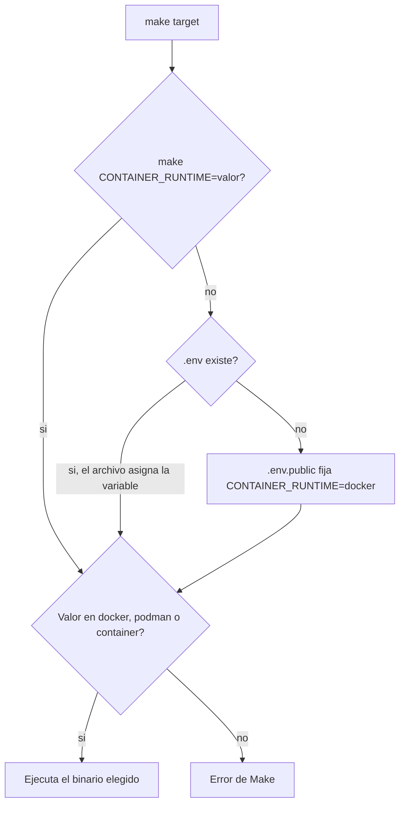

# Plan: Container runtime on the Unified CLI Facade

## Goal

Los paquetes container-first siguen entrando solo por `make <target>`. El Makefile deja de asumir el binario `docker` y usa el motor que indique `CONTAINER_RUNTIME`: `docker`, `podman` o `container` (CLI de Apple). El default comprometido es `CONTAINER_RUNTIME=docker` en cada `.env.public` del alcance, con un comentario en la parte superior del archivo que lista esas tres herramientas. Los workflows de GitHub que ejecutan Make en estos paquetes fijan `CONTAINER_RUNTIME: docker`. El nombre de la variable es `CONTAINER_RUNTIME`.

El host de estos Makefile es Linux o macOS. Las recipes usan el shell Unix (`sh`, `grep`, `awk`, `xargs`). Se eliminan las ramas `ifeq ($(OS),Windows_NT)` y cualquier llamada a PowerShell.

## Scope

- Affected component(s): `backend/`, `conference-manager/`, Knowledge MCP (convención ingestada), workflows de PR de esos dos árboles.
- Artefacto de este pedido: [docs/plans/20261021-container-runtime-make-facade.md](docs/plans/20261021-container-runtime-make-facade.md), copiado de [docs/plans/TEMPLATE.md](docs/plans/TEMPLATE.md).
- Out of scope: Makefile de `cli/`, `mobile-app/`, `tools/knowledge-mcp/` y la raíz del repo; IaC en `cloud/` (sigue en Terraform del host); actions que llaman a Docker directamente (`ci_cm_components.yml`, `container-build`, push de imágenes, `setup-buildx`); renombrar `Dockerfile`, carpetas `docker-compose/` o el target `docker-clean`; renombrar el campo `makefile_wraps_docker` de `compare_gaps`.

## Contract / interface

Variable Make y de entorno: `CONTAINER_RUNTIME`.

Valores permitidos: `docker`, `podman`, `container`. Cualquier otro valor hace fallar Make con un error explícito.

Cada `.env.public` del alcance abre con este bloque. El comentario va en la parte superior del archivo, antes del resto de variables:

```bash
# Container engine. Allowed tools: docker | podman | container
CONTAINER_RUNTIME=docker
```

Archivos de la fase 1:

- [backend/fastapi-rest-tpl/.env.public](backend/fastapi-rest-tpl/.env.public)
- [backend/nestjs-rest-tpl/.env.public](backend/nestjs-rest-tpl/.env.public)
- [backend/nestjs-gql-tpl/.env.public](backend/nestjs-gql-tpl/.env.public)

Archivos de la fase 2:

- [conference-manager/.env.public](conference-manager/.env.public)
- [conference-manager/shared-services/.env.public](conference-manager/shared-services/.env.public)
- [conference-manager/ms-conference-api/.env.public](conference-manager/ms-conference-api/.env.public)
- [conference-manager/ms-conference-admin/.env.public](conference-manager/ms-conference-admin/.env.public)
- [conference-manager/ms-conference-webapp/.env.public](conference-manager/ms-conference-webapp/.env.public)

Precedencia. Make incluye `.env` si existe y, si no, `.env.public`. Un `=` en el archivo incluido pisa un `export` del shell. El argumento de la línea de `make` pisa el archivo.



Override local persistente: un `.env` ignorado por git que incluya `CONTAINER_RUNTIME=podman` o `CONTAINER_RUNTIME=container`. Override de una sola invocación: `make build-dev CONTAINER_RUNTIME=podman`. El `?=` del Makefile solo cubre un archivo incluido que no traiga la variable. Los workflows declaran `CONTAINER_RUNTIME: docker`, el mismo valor que `.env.public`.

Fragmento canónico, justo después de `include $(ENV_FILE)`, copiado en cada Makefile (los templates se copian fuera del monorepo y no pueden depender de un include compartido):

```makefile
CONTAINER_RUNTIME ?= docker
ifeq ($(filter $(CONTAINER_RUNTIME),docker podman container),)
$(error CONTAINER_RUNTIME must be docker, podman, or container)
endif
```

Sustitución del binario en las recipes Unix: `build`, `run`, `compose`, `volume`, `network`, `ps`, `exec`, `kill`, `stop`, `container prune`, `system prune`. Donde hoy existe `DOCKER_COMPOSE = docker compose`, pasa a `CONTAINER_COMPOSE = $(CONTAINER_RUNTIME) compose`.

Host Unix. En cada Makefile del alcance se borra el bloque `ifeq ($(OS),Windows_NT)` y se deja solo la rama que hoy está en el `else`:

- `help` queda con `grep` y `awk` sobre el Makefile.
- `docker-clean` queda con `ps` y `xargs` en el shell Unix, usando `$(CONTAINER_RUNTIME)`.
- `DIR` queda en la forma Unix ya presente: `$(PACKAGE_DIR)` / `$(abspath .)` en FastAPI, `"$$(pwd)"` en el resto.
- `USER_HOME` en los dos templates NestJS queda en `$(shell echo $$HOME)`. Se elimina `%USERPROFILE%`.
- `stop` de [conference-manager/ms-conference-webapp/Makefile](conference-manager/ms-conference-webapp/Makefile) hoy usa `xargs -r` en la rama Unix. `-r` es de GNU xargs y el `xargs` de macOS no lo tiene. Al dejar una sola recipe, ese target pasa a un guardia POSIX que no llama a `stop` si no hay ids:

```makefile
stop: ## Stop running webapp dev container
	@ids=$$($(CONTAINER_RUNTIME) ps -q --filter ancestor=$(PROJECT_NAME)/$(COMPOSE_PROJECT_NAME)-webapp-dev); \
	if [ -n "$$ids" ]; then printf '%s\n' $$ids | xargs $(CONTAINER_RUNTIME) stop; fi
```

`docker-clean` recibe el mismo guardia de lista vacía, para que `make docker-clean` sin contenedores termine bien en Linux y en macOS:

```makefile
docker-clean: ## stop and kill all running containers
	@ids=$$($(CONTAINER_RUNTIME) ps -qa); \
	if [ -n "$$ids" ]; then printf '%s\n' $$ids | xargs $(CONTAINER_RUNTIME) kill; fi; \
	$(CONTAINER_RUNTIME) container prune --force; \
	$(CONTAINER_RUNTIME) system prune --force
```

Inventario de bloques `Windows_NT` a eliminar:

- [backend/fastapi-rest-tpl/Makefile](backend/fastapi-rest-tpl/Makefile): `DIR`, `docker-clean`, `help`.
- [backend/nestjs-rest-tpl/Makefile](backend/nestjs-rest-tpl/Makefile) y [backend/nestjs-gql-tpl/Makefile](backend/nestjs-gql-tpl/Makefile): `USER_HOME`, `DIR`, `docker-clean`, `help`.
- [conference-manager/Makefile](conference-manager/Makefile): `DIR`, `help`, `docker-clean`.
- [conference-manager/shared-services/Makefile](conference-manager/shared-services/Makefile): `help`.
- [conference-manager/ms-conference-api/Makefile](conference-manager/ms-conference-api/Makefile): `DIR`, `docker-clean`, `help`.
- [conference-manager/ms-conference-admin/Makefile](conference-manager/ms-conference-admin/Makefile): `DIR`, `help`, `docker-clean`.
- [conference-manager/ms-conference-webapp/Makefile](conference-manager/ms-conference-webapp/Makefile): `DIR`, `docker-clean`, `stop`, `help`.

El facade cambia el binario. Los flags actuales se mantienen (`--platform`, `--rm`, `--workdir`, `-v`, `-e`, `-it`, `-d`, `--env-file`, `-f`, `--net=host`, `--filter`, `--build-arg`). `podman compose` necesita un proveedor de Compose. El CLI `container` de Apple debe aceptar ese mismo subconjunto; si un target falla por incompatibilidad del motor, se actualiza este plan antes de añadir ramas por motor.

El alias MCP `container` sigue resolviendo a `container-first`. El valor de entorno `container` es el binario de Apple. Alias nuevo de catálogo: `container-runtime` y `container-engine` apuntan a `makefile`.

El campo `makefile_wraps_docker` de `compare_gaps` conserva el nombre. Su significado pasa a ser: el Makefile envuelve un motor de contenedores (`CONTAINER_RUNTIME`), no `npm`/`python` en el host. Sigue haciendo falta un `Dockerfile` (formato de imagen).

## Implementation steps

1. Guardar este plan en [docs/plans/20261021-container-runtime-make-facade.md](docs/plans/20261021-container-runtime-make-facade.md) y parar hasta que se pida implementar la fase 1.
2. Fase 1 — convención y templates de backend, en un solo PR.
   - Reescribir la sección **Core Rule: Makefile Is the Unified CLI Facade** y **Where You Build, You Run** en [agents/shared/context/development-guidance.md](agents/shared/context/development-guidance.md). Añadir un heading `Container engine` con la variable, los tres valores, el bloque de `.env.public`, la precedencia (línea de `make`, luego `.env`, luego `.env.public`) y la regla de que nadie invoca `docker`, `podman` ni `container` a mano. En esa misma regla de facade, dejar escrito que el host de estos Makefile es Linux o macOS y que las recipes son Unix (`sh`, `grep`, `awk`, `xargs`), sin ramas `Windows_NT` ni PowerShell. Renombrar **Docker Platform** a **Container platform** y dejar ahí `PLATFORM` junto a `CONTAINER_RUNTIME`.
   - En [tools/knowledge-mcp/src/knowledge/ingest.py](tools/knowledge-mcp/src/knowledge/ingest.py), cambiar el needle `docker platform` por `container platform` y etiquetar `container engine` con `makefile`, `unified-cli-facade` y `container-first`. El archivo ya tiene `FORCE_TAGS` hacia `makefile`, así que `get_convention("makefile")` y `get_convention("unified-cli-facade")` incluyen la sección.
   - Alias en [tools/knowledge-mcp/src/knowledge/catalog.py](tools/knowledge-mcp/src/knowledge/catalog.py).
   - Ajustar el detalle del gap en [tools/knowledge-mcp/src/knowledge/gaps.py](tools/knowledge-mcp/src/knowledge/gaps.py), la etiqueta `rule` en [tools/knowledge-mcp/data/reference.yaml](tools/knowledge-mcp/data/reference.yaml), el `how` de servicios en [tools/knowledge-mcp/data/scaffold.yaml](tools/knowledge-mcp/data/scaffold.yaml) y la tabla de [docs/KnowledgeMCP.md](docs/KnowledgeMCP.md).
   - Alinear [docs/adr/0001-makefile-unified-cli-facade.md](docs/adr/0001-makefile-unified-cli-facade.md), [CLAUDE.md](CLAUDE.md), [.cursor/rules/000-core.mdc](.cursor/rules/000-core.mdc) y [.cursor/rules/backend.mdc](.cursor/rules/backend.mdc). El ADR no entra al índice del MCP; la fuente que el servidor lee es `development-guidance.md`.
   - Aplicar el fragmento, la sustitución del binario y la eliminación de ramas `Windows_NT` / PowerShell en [backend/fastapi-rest-tpl/Makefile](backend/fastapi-rest-tpl/Makefile), [backend/nestjs-rest-tpl/Makefile](backend/nestjs-rest-tpl/Makefile) y [backend/nestjs-gql-tpl/Makefile](backend/nestjs-gql-tpl/Makefile). `help` y `docker-clean` quedan con la recipe Unix única descrita en el contrato.
   - Añadir al inicio de los tres `.env.public` de backend el comentario de herramientas y `CONTAINER_RUNTIME=docker`.
   - Actualizar los README de esos tres templates: el host es Linux o macOS, con Make y un motor (`docker`, `podman` o `container`). El default está en `.env.public`. El override local es `.env` o `make <target> CONTAINER_RUNTIME=podman`. El ejemplo de FastAPI que hoy instala Docker Desktop deja de ser la única opción de motor.
   - En [.github/workflows/pull_request_backend.yml](.github/workflows/pull_request_backend.yml), añadir `CONTAINER_RUNTIME: docker` junto a `PLATFORM` en el `env` del workflow.
   - Tests del MCP: afirmar que `get_convention("makefile")` y `get_convention("unified-cli-facade")` contienen `CONTAINER_RUNTIME`, `podman`, `container` y que el host es Linux o macOS, y que el default es `docker`. Correr `make unit-tests` en `tools/knowledge-mcp/`. En cada template, `make -n build-dev` muestra `docker` por defecto, `CONTAINER_RUNTIME=podman make -n build-dev` muestra `podman`, y un valor inválido aborta Make. `rg` confirma que los tres Makefile ya no contienen `powershell`, `Windows_NT` ni `%USERPROFILE%`.
3. Fase 2 — conference-manager, después de que la fase 1 esté aceptada y con el mismo fragmento. No mezclarla en el PR de backend.
   - [conference-manager/Makefile](conference-manager/Makefile)
   - [conference-manager/shared-services/Makefile](conference-manager/shared-services/Makefile) (`docker network`, `docker volume`, `DOCKER_COMPOSE`)
   - [conference-manager/ms-conference-api/Makefile](conference-manager/ms-conference-api/Makefile) (hay llamadas `docker compose` sueltas además de `DOCKER_COMPOSE`)
   - [conference-manager/ms-conference-admin/Makefile](conference-manager/ms-conference-admin/Makefile)
   - [conference-manager/ms-conference-webapp/Makefile](conference-manager/ms-conference-webapp/Makefile) (`stop` con el guardia POSIX en lugar de `xargs -r`; se mantiene `--net=host` en los `run` que ya lo usan)
   - Añadir al inicio de los cinco `.env.public` de conference-manager el mismo comentario y `CONTAINER_RUNTIME=docker`.
   - [.github/workflows/pull_request_cm_components.yml](.github/workflows/pull_request_cm_components.yml): `CONTAINER_RUNTIME: docker` en el `env` del workflow.
   - Misma verificación con `make -n` en cada paquete, y `rg` para confirmar que esos cinco archivos ya no contienen `powershell`, `Windows_NT` ni `%USERPROFILE%`. `ci_cm_components.yml` publica imágenes con actions de Docker y no pasa por este facade.

## Pull request

Dos PRs. El cuerpo sale de [.github/pull_request_template.md](.github/pull_request_template.md), con todos los headings. Sin atribución de herramienta.

- Fase 1, rama `ade/jose/feat/container-runtime-facade`. Checkboxes: App Developer Experience, Knowledge MCP, FastAPI template, NestJS REST, NestJS GQL. Tipo `build` / `docs` / `ci` según el commit. Commits separados por scope (`docs(ade)`, `build(fastapi-rest-tpl)`, `build(nestjs-rest-tpl)`, `build(nestjs-gql-tpl)`, `ci`, `test(knowledge-mcp)`).
- Fase 2, rama `ade/jose/feat/cm-container-runtime-facade`. Checkboxes: cm-tools, cm-webapp, cm-admin, cm-api. Commits por alias (`build(cm-api)`, `build(cm-admin)`, `build(cm-webapp)`, `build(cm-tools)` para `shared-services/` y el Makefile raíz de conference-manager, más `ci`).

## Risks

- `podman compose` falla si no hay proveedor de Compose instalado. El Makefile no lo instala.
- El CLI `container` de Apple puede rechazar `compose`, `system prune --force`, `ps -qa` o `--net=host`. Eso se trata como límite del motor, no como un segundo conjunto de recipes.
- El `=` de `.env.public` pisa un `export CONTAINER_RUNTIME` del shell. Quien quiera `podman` o `container` en local lo escribe en `.env` o lo pasa en la línea de `make`. Si `.env` existe, Make no lee `.env.public`, así que ese archivo local tiene que traer su propio `CONTAINER_RUNTIME`.
- Estos Makefile dejan de tener ruta de ejecución en Windows. El host soportado es Linux (CI en `ubuntu-24.04`) y macOS.
- `xargs -r` no existe en el `xargs` de macOS. `stop` del webapp y `docker-clean` usan el guardia `if [ -n ... ]` para no depender de esa flag.

## Acceptance criteria

- [ ] `docs/plans/20261021-container-runtime-make-facade.md` existe y sigue el template.
- [ ] `get_convention("makefile")` y `get_convention("unified-cli-facade")` describen `CONTAINER_RUNTIME`, los tres motores, el default `docker`, el host Linux/macOS y que el caller solo usa Make.
- [ ] Ningún recipe de los tres Makefile de `backend/` ni de los cinco de `conference-manager/` invoca el binario `docker` fijo. Siguen existiendo rutas `docker-compose/` y el target `docker-clean`.
- [ ] Esos ocho Makefile no contienen `powershell`, `Windows_NT` ni `%USERPROFILE%`. `help` usa `grep`/`awk`. `docker-clean` y el `stop` del webapp usan el guardia POSIX de lista vacía.
- [ ] Los ocho `.env.public` del alcance empiezan con el comentario `Allowed tools: docker | podman | container` y la línea `CONTAINER_RUNTIME=docker`.
- [ ] `pull_request_backend.yml` y `pull_request_cm_components.yml` definen `CONTAINER_RUNTIME: docker`.
- [ ] `make -n build-dev` usa `docker` sin la variable, usa el binario exportado cuando la variable es válida, y Make aborta si el valor no está en la lista.
- [ ] `make unit-tests` de `tools/knowledge-mcp/` pasa, con cobertura de al menos 80%.

## Impacted consumers

- Servicios nuevos copiados de `fastapi-rest-tpl`, `nestjs-rest-tpl` y `nestjs-gql-tpl`.
- Desarrollo local de Conference Manager (api, admin, webapp, shared-services y el Makefile raíz).
- Agentes y repos que llaman a `get_convention("makefile")`, `get_convention("unified-cli-facade")` o `get_convention("container-first")`.
- Clientes de `compare_gaps`: el campo `makefile_wraps_docker` no cambia de nombre; cambia el texto que explica que `true` significa motor de contenedores.
